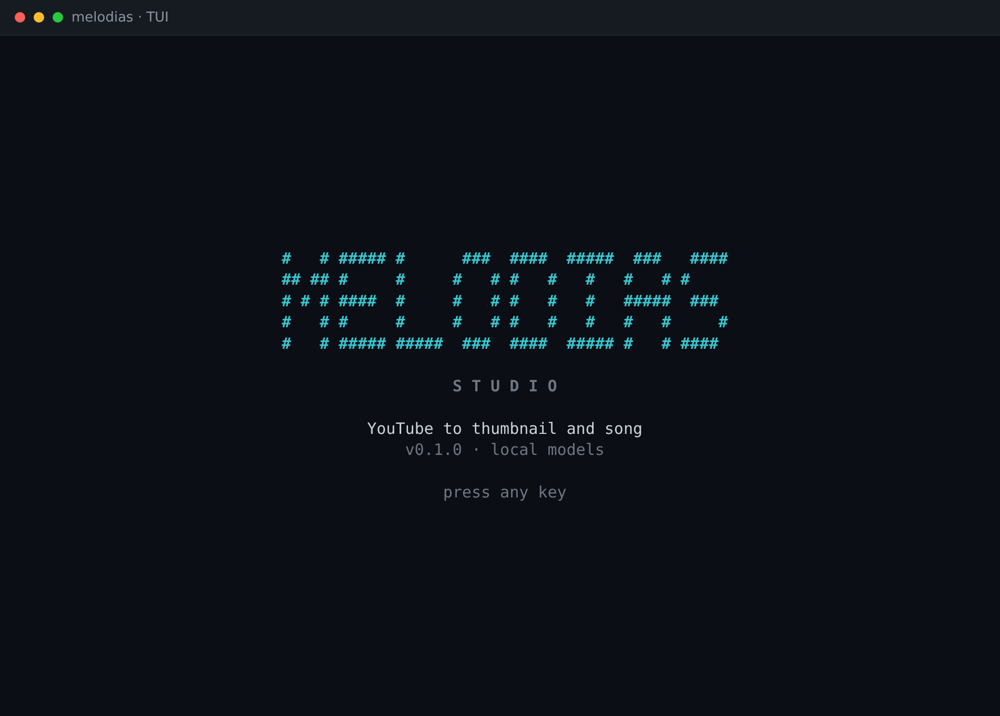
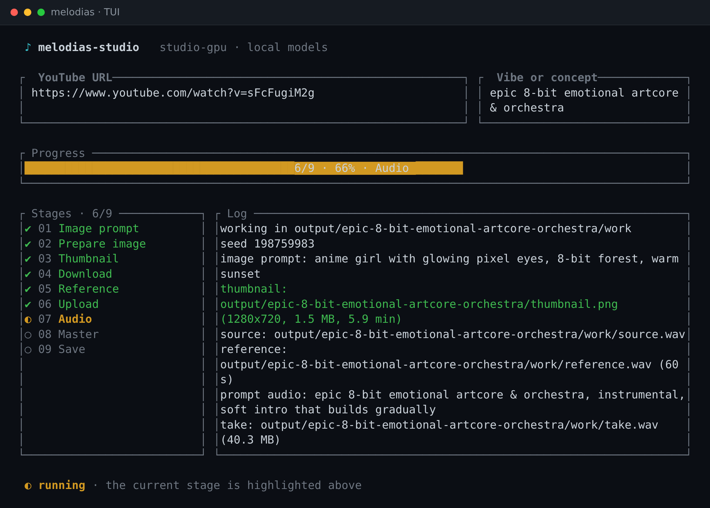
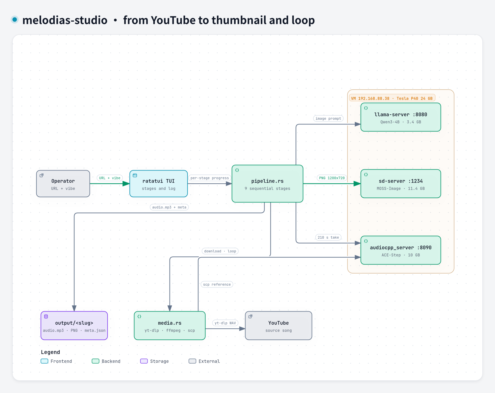

# melodias-studio

A Rust TUI that turns a YouTube song into two deliverables: **one thumbnail** and **one three to four minute instrumental track**, using local models.

The pipeline is not tied to one machine. It talks to three HTTP services (chat, image and music) and to `yt-dlp` and `ffmpeg`. The defaults point at a single GPU box over SSH, but endpoints, model ids, the host, folders, master settings and the lifecycle commands come from environment variables or `~/.config/melodias-studio/config.toml`.



```
YouTube URL + vibe
        │
        ├─ llama-server ───► thumbnail prompt (needs the GPU)
        ├─ sd-server ──────► 1280x720 thumbnail
        ├─ yt-dlp ─────────► source audio
        ├─ ffmpeg ─────────► 60 s excerpt with the most energy (timbre reference)
        ├─ audiocpp_server ► 210 s take with reference_audio
        └─ ffmpeg ─────────► fade-in/out + loudnorm -15 LUFS
```

The order is deliberate: the image runs first because it is the most fragile stage, and the download plus audio form one block that only needs the audio server.

## Requirements

- Rust 1.85+ (`rustup default stable`) to build from source.
- `yt-dlp`, `ffmpeg` and `ffprobe` on `PATH`.
- Three HTTP services:
  - a chat completions server for the thumbnail prompt (llama.cpp or any OpenAI-compatible endpoint)
  - a stable-diffusion.cpp server for the image (OpenAI images API)
  - an audio.cpp server with the ACE-Step family for the music (`/v1/tasks/run`)
- `ssh` and `scp` only when the services run on another host or when the lifecycle commands need them.

No particular GPU or model is required. Set `SSH_HOST` to an empty string and empty the lifecycle commands to run everything on this machine.

### Example setup

The defaults describe one machine with a single 24 GB P40: `llama-server` with `Qwen3-4B-Instruct-2507` on `:8080`, `sd-server` with MOSS-Image on `:1234` and `audiocpp_server` with ACE-Step on `:8090`, all reached over SSH. The 4B model keeps ~3.4 GB busy, so the prompt step and `sd-server` (11.4 GB) can hold the GPU at the same time. The audio stage stops both `sd-server` and the LLM: ACE-Step with a timbre reference needs the whole card. `deploy/audio-server.json` enables `ace_step.mem_saver`, which returns the session to ~14.7 GB between requests. Use it as a reference, not as a requirement.

## Deploy the server scripts

The scripts in [`deploy/`](deploy/) start, stop and report the three services. They are optional: if you start the servers yourself, leave the lifecycle commands empty.

`deploy/env.sh` holds the host layout: binary paths, model paths, ports, and the run and log folders. The `serve-*.sh` scripts source it, so a different machine only needs different values there. Edit the deployed copy, or export the variables before running a script.

```bash
make deploy
```

That copies `env.sh`, the scripts and `audio-server.json` to `/home/ubuntu/bin` on `SSH_HOST`, then fixes permissions. Each script answers `start`, `stop` and `status`.

## Install

```bash
make install
melodias
```

`make install` builds the release binary and copies it to `~/.local/bin/melodias`. Override `BINDIR` or `PREFIX` if you keep binaries elsewhere, and make sure that folder is on `PATH`. `make uninstall` removes it. `cargo run` still works for development.

### TUI



- `Tab` switches between the URL and the vibe.
- `Enter` moves to the next field, then starts the run.
- `q` quits, only once the run finished.

Each stage shows its state, the progress bar tracks how many are done, and the log prints every step, including the prompt the LLM wrote and the seed of the take.

### Headless run

Passing the URL and the vibe as arguments runs the same pipeline without the full screen UI. Each stage is printed as its own colored group with an icon, and tool output from `yt-dlp`, `ffmpeg` and `ssh` goes to the run log instead of the screen:

```bash
MELODIAS_LOG=output/run.log melodias 'https://www.youtube.com/watch?v=...' 'epic 8-bit orchestral finale'
```

The log receives the same lines as plain text, so it can be read later without escape codes. Quote the URL: a YouTube link copied from a playlist carries `&list=` and `&index=`, which the shell would otherwise split. The exit code is non-zero when a stage fails.

The image stage reports its own duration and the size of the PNG it got back, and warns when the server returned something other than the requested size.

### Make shortcuts

The `Makefile` wraps the common commands:

| Target | What it does |
| --- | --- |
| `make run` | Opens the TUI |
| `make install` / `make uninstall` | Installs or removes `~/.local/bin/melodias` |
| `make generate URL='...' VIBE='...'` | Runs headless and writes `output/run-<timestamp>.log` |
| `make log` | Prints the last 40 lines of the newest log |
| `make check` | `fmt --check`, build, `clippy -D warnings` and tests |
| `make status` | Service state on the VM over SSH |
| `make deploy` | Copies `deploy/` to the VM and fixes permissions |

`make generate` builds the release binary first, so the run does not pay debug overhead.

## Configuration

Settings come from three places, in this order: environment variables, then `~/.config/melodias-studio/config.toml`, then the built-in defaults. `XDG_CONFIG_HOME` is respected and `MELODIAS_CONFIG` overrides the file path.

Start from the commented example:

```bash
mkdir -p ~/.config/melodias-studio
cp config.example.toml ~/.config/melodias-studio/config.toml
```

| Variable | Default | Meaning |
| --- | --- | --- |
| `AUDIO_URL` | `http://192.168.88.38:8090` | `audiocpp_server` |
| `AUDIO_MODEL` | `ace-step` | model id registered on the server |
| `SD_URL` | `http://192.168.88.38:1234` | `sd-server` |
| `LLM_URL` | `http://192.168.88.38:8080` | `llama-server` |
| `LLM_MODEL` | `local` | model name the server expects |
| `SSH_HOST` | `root@192.168.88.38` | target for the reference and lifecycle commands; empty runs locally |
| `REMOTE_REF_DIR` | `/models/ref` | remote folder for references |
| `OUT_DIR` | `output` | local output |
| `GPU_LABEL` | `local models` | label in the header and the splash |
| `DURATION_SEC` | `210` | take length |
| `STEPS` | `32` | diffusion steps |
| `GUIDANCE` | `5` | CFG |
| `SAMPLER` | `heun` | `euler` or `heun` |
| `WIDTH` / `HEIGHT` | `1280` / `720` | thumbnail size |
| `REFERENCE_SEC` | `60` | length of the timbre reference, clamped to 5..120 |
| `FADE_IN_SEC` | `1.5` | master fade-in |
| `FADE_OUT_SEC` | `3.0` | master fade-out |
| `LOUDNESS_LUFS` | `-15` | master loudness target |

### GPU lifecycle commands

They run between stages, over SSH when `SSH_HOST` is set. The defaults point at the `deploy/` scripts; override or empty them to manage the servers by hand:

| Variable | Default | When it runs |
| --- | --- | --- |
| `LLM_START_CMD` | `/home/ubuntu/bin/serve-llm.sh start` | before the thumbnail prompt |
| `LLM_STOP_CMD` | `/home/ubuntu/bin/serve-llm.sh stop` | before the audio stage, to free 3.4 GB |
| `SD_START_CMD` | `/home/ubuntu/bin/serve-sd.sh start` | before the thumbnail |
| `SD_STOP_CMD` | `/home/ubuntu/bin/serve-sd.sh stop` | before the audio stage |
| `AUDIO_START_CMD` | `/home/ubuntu/bin/serve-audio.sh start` | before the audio stage |
| `AUDIO_STOP_CMD` | `/home/ubuntu/bin/serve-audio.sh stop` | after the take, even if it failed |
| `AUDIO_NEGATIVE_PROMPT` | `vocals, singing, voice, choir, lyrics, humming, vocal chops, spoken word` | steering text that keeps voices out |

The app waits for `/health` on the service it just started, up to 180 s, before moving on. With `SSH_HOST` empty the reference is not copied and the audio server reads it from the local path.

## Output

```
output/<slug>/
├── audio.mp3      # 3 min song, 320 kbps, -15 LUFS
├── thumbnail.png  # 1280x720
├── meta.json      # seed, prompts, parameters and source URL
└── work/          # source, reference and raw take
```

## Architecture diagram

[](docs/arquitectura.html)

[`docs/arquitectura.html`](docs/arquitectura.html) is a self-contained interactive map of the pipeline, the three GPU services and the VRAM order. It shows the example deployment used by the defaults; the code paths are the same for any host. It opens offline in a browser and needs no server. The source is [`docs/arquitectura.json`](docs/arquitectura.json), so the diagram can be regenerated with the [Archify](https://github.com/tt-a1i/archify) skill:

```bash
node ~/.agents/skills/archify/bin/archify.mjs finalize architecture docs/arquitectura.json docs/arquitectura.html --repo-root . --quality showcase
```

## Design notes

- **The reference is an excerpt, not the whole song.** ACE-Step samples three 10 s windows from the file, so the app picks the minute with the highest average energy and skips intros and breakdowns. It conditions timbre and style, not the melody: the result is not a cover of the source.
- **Every track is instrumental.** The vibe is sent as `<vibe>, instrumental` and `options.negative_prompt` lists vocals, singing, choir, lyrics and humming. ACE-Step uses that text as the unconditional CFG prompt, so it steers away from voices instead of hoping the caption is ignored.
- **The audio parameters travel inside `options`.** `/v1/tasks/run` only forwards the nested `options` object to the ACE-Step parser, so `duration_sec`, `reference_audio` and `sampler_mode` at the top level of `request` are silently dropped. Sent inside `options`, `duration_sec` returns an exact length.
- **The take is the song, not a loop.** ACE-Step writes its own intro and outro, so the master keeps both: it normalizes to `LOUDNESS_LUFS`, fades in over `FADE_IN_SEC` and fades out over `FADE_OUT_SEC`. Nothing is crossfaded back into the intro. The prompt asks for a soft intro that builds and a resolved outro.
- **The LLM writes the thumbnail prompt.** The vibe goes in as a concept and comes back as an English prompt, with the pixel-art style pinned in the system prompt.
- **Stages fail loudly and stop the run.** Each step reports its own error in the log so you know which service to look at.

## Roadmap

- [ ] Cancel a run in progress and retry a single stage.
- [ ] Read the video title to name the output folder instead of the vibe.
- [ ] Write the video entry straight into `jd-llm/projects/melodias8bit/videos/`.
- [ ] Compare two takes side by side before picking one.
