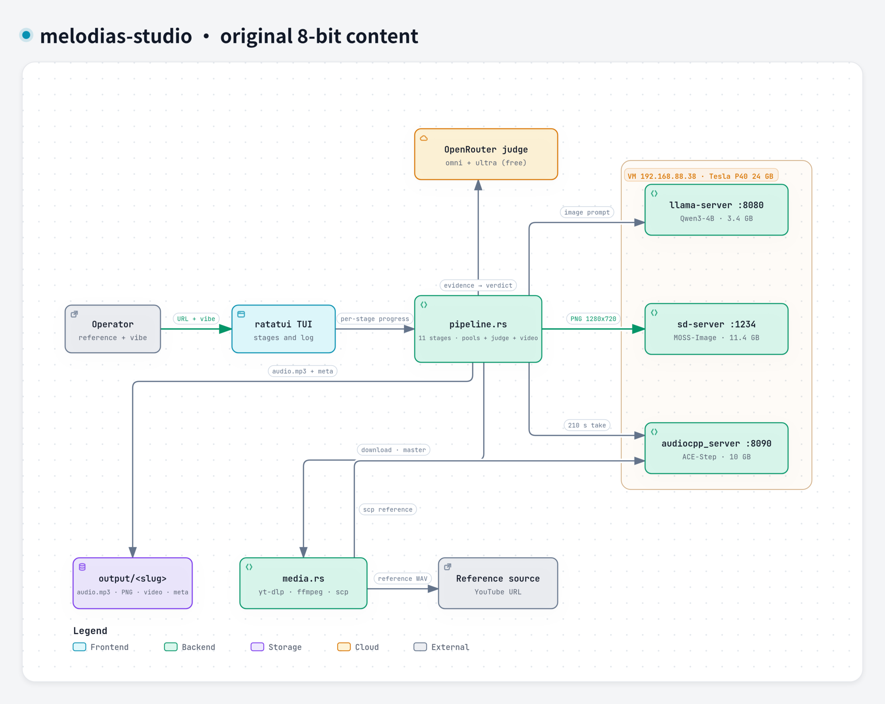

# Architecture

```
vibe + reference URL
        │
        ├─ llama-server ───► thumbnail prompt (needs the GPU)
        ├─ sd-server ──────► 1280x720 thumbnail
        ├─ yt-dlp ─────────► reference WAV
        ├─ ffmpeg ─────────► 60 s excerpt with the most energy
        ├─ audiocpp_server ► 210 s original take with reference_audio
        └─ ffmpeg ─────────► fade-in/out + loudnorm -15 LUFS
```

The reference only conditions timbre. The pipeline does not convert the source: the thumbnail and the track are new material generated from the vibe.

The order is deliberate: the image runs first because it is the most fragile stage, and the download plus audio form one block that only needs the audio server.

[](arquitectura.html)

[`arquitectura.html`](arquitectura.html) is a self-contained interactive map of the pipeline, the three GPU services and the VRAM order. It shows the example deployment used by the defaults; the code paths are the same for any host. It opens offline in a browser and needs no server. The source is [`arquitectura.json`](arquitectura.json), so the diagram can be regenerated with the [Archify](https://github.com/tt-a1i/archify) skill:

```bash
node ~/.agents/skills/archify/bin/archify.mjs finalize architecture docs/architecture/arquitectura.json docs/architecture/arquitectura.html --repo-root . --quality showcase
```

## Design notes

- **The reference is an excerpt, not the whole song.** ACE-Step samples three 10 s windows from the file, so the app picks the minute with the highest average energy and skips intros and breakdowns. It conditions timbre and style, not the melody: the result is not a cover of the source.
- **The medium is a rule.** Images are pinned to `IMAGE_STYLE` (default 8-bit pixel art) and audio to `AUDIO_STYLE` (default 8-bit chiptune). The vibe adds mood and references, not the medium.
- **Every track is instrumental.** The vibe is sent as `<vibe>, instrumental` and `options.negative_prompt` lists vocals, singing, choir, lyrics and humming. ACE-Step uses that text as the unconditional CFG prompt, so it steers away from voices instead of hoping the caption is ignored.
- **The audio parameters travel inside `options`.** `/v1/tasks/run` only forwards the nested `options` object to the ACE-Step parser, so `duration_sec`, `reference_audio` and `sampler_mode` at the top level of `request` are silently dropped. Sent inside `options`, `duration_sec` returns an exact length.
- **The take is the song, not a loop.** ACE-Step writes its own intro and outro, so the master keeps both: it normalizes to `LOUDNESS_LUFS`, fades in over `FADE_IN_SEC` and fades out over `FADE_OUT_SEC`. Nothing is crossfaded back into the intro. The prompt asks for a soft intro that builds and a resolved outro.
- **The LLM writes the thumbnail prompt.** The vibe goes in as a concept and comes back as an English prompt, with the pixel-art style pinned in the system prompt.
- **Stages fail loudly and stop the run.** Each step reports its own error in the log so you know which service to look at.

The proposed next step, candidate pools with local critics and an optional cloud judge, lives in [adversary-review.md](../adversary-review.md).
