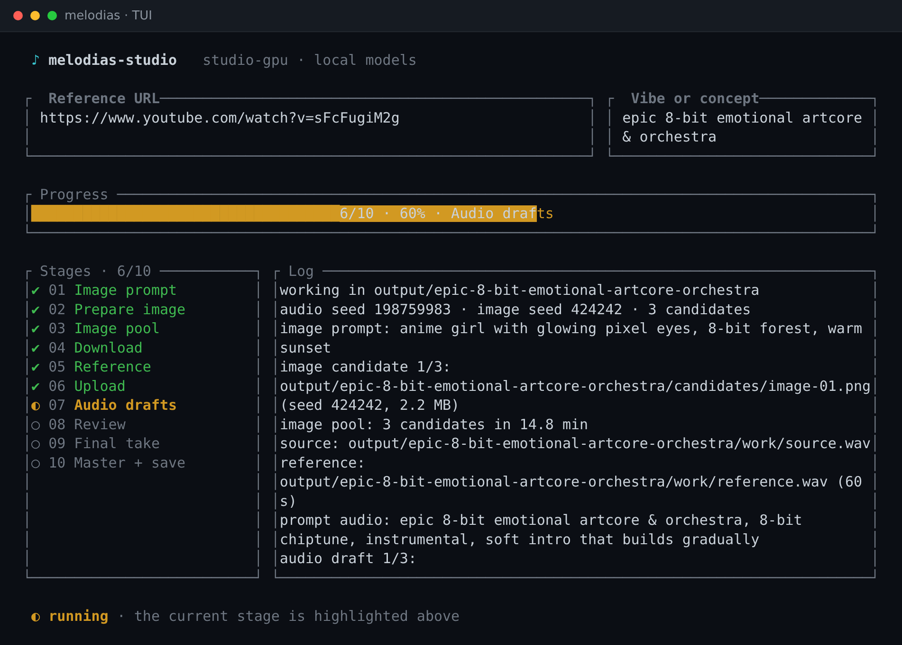
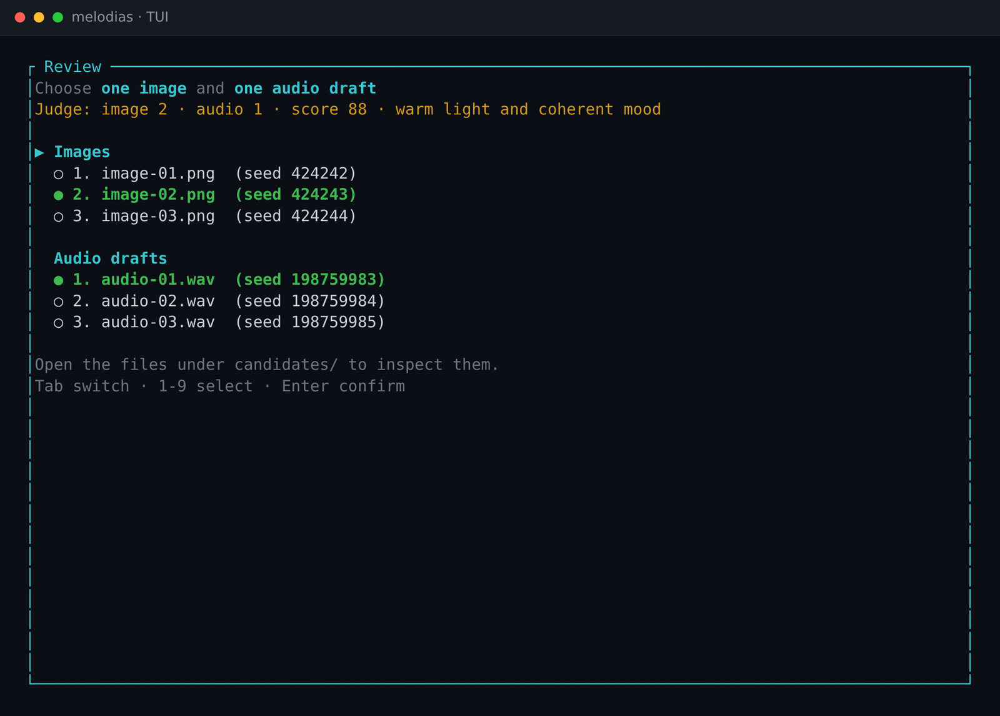

# Usage

## TUI



```bash
melodias
```

The reference URL is optional in the product vision but required by the current build. It is used only to condition timbre.

- `Tab` switches between the URL and the vibe.
- `Enter` moves to the next field, then starts the run.
- `q` quits, only once the run finished.

When the pools are ready the run pauses on a review screen. Pick one image and one audio draft with `1-9`, switch sections with `Tab`, and continue with `Enter`. The candidates live under `output/<slug>/candidates/`; open them to compare.



Each stage shows its state, the progress bar tracks how many are done, and the log prints every step, including the prompt the LLM wrote and the seed of the take. A splash with the version appears for a moment on start.

## Headless run

Passing the reference URL and the vibe as arguments runs the same pipeline without the full screen UI. Each stage is printed as its own colored group with an icon, and tool output from `yt-dlp`, `ffmpeg` and `ssh` goes to the run log instead of the screen:

```bash
MELODIAS_LOG=output/run.log melodias 'https://www.youtube.com/watch?v=...' 'epic 8-bit orchestral finale'
```

The headless mode auto-selects candidate 1 for both pools, so use the TUI when you want to choose. The log receives the same lines as plain text, so it can be read later without escape codes. Quote the URL: a YouTube link copied from a playlist carries `&list=` and `&index=`, which the shell would otherwise split. The exit code is non-zero when a stage fails.

The image stage reports its own duration and the size of the PNG it got back, and warns when the server returned something other than the requested size.

## Video

See [video.md](video.md) for how the renderer works and which options exist for richer effects.

Every finished run leaves `video.mp4` next to the audio. If you have a run from before the video stage, assemble it without touching the GPU:

```bash
melodias video output/<slug>
# or
make video DIR=output/<slug>
```

The video is the chosen still with a slow zoom, glowing pixel particles, the audio waveform and edge fades, at `VIDEO_WIDTH` x `VIDEO_HEIGHT` (1920x1080 by default).

### Produced video with Remotion

For the richer composition (bokeh overlays, birds, audio-reactive bars, channel label):

```bash
cd video && pnpm install && cd ..
melodias render output/<slug>
```

That takes about twelve minutes and keeps the previous ffmpeg video as `video-ffmpeg.mp4`. See [video.md](video.md).

### Regenerate the thumbnail

To replace the chosen image of a finished run, reuse its prompt and seed, and rebuild the video without touching the rest:

```bash
melodias image output/<slug>
# or
make image DIR=output/<slug>
```

It keeps the old file as `thumbnail-old.png`, appends the new image to `candidates/`, updates `meta.json` and rebuilds `video.mp4`. The current prompt is sanitized so the eyes stay natural and the configured image negative prompt is applied.

## Make shortcuts

| Target | What it does |
| --- | --- |
| `make run` | Opens the TUI |
| `make install` / `make uninstall` | Installs or removes `~/.local/bin/melodias` |
| `make generate URL='...' VIBE='...'` | Runs headless and writes `output/run-<timestamp>.log` |
| `make image DIR=output/<slug>` | Regenerates the thumbnail of a finished run |
| `make render DIR=output/<slug>` | Produces the Remotion video |
| `make video DIR=output/<slug>` | Assembles the fast ffmpeg video |
| `make log` | Prints the last 40 lines of the newest log |
| `make check` | `fmt --check`, build, `clippy -D warnings` and tests |
| `make status` | Service state on the host over SSH |
| `make deploy` | Copies `deploy/` to the host and fixes permissions |

`make generate` builds the release binary first, so the run does not pay debug overhead.

## Output

```
output/<slug>/
├── audio.mp3      # 3 min song, 320 kbps, -15 LUFS
├── thumbnail.png  # the chosen 1280x720 candidate
├── meta.json      # candidates, seeds, prompts, selection and source URL
├── candidates/    # N image candidates and N audio drafts
├── video.mp4      # 1920x1080, image + particles + waveform
├── video-ffmpeg.mp4  # only when Remotion rendered over the fast version
└── work/          # source, reference and final take
```

## Screenshots

The images in these docs come from the test backend, not from a manual capture. Regenerate them with:

```bash
DUMP_TUI_HTML_DIR=/tmp/tui cargo test draws_without_leaving_the_terminal
```

That writes `tui.html` and `tui-splash.html`; render them with a browser at the size you need.
